# recon

Reconciles a SOURCE export (OLTP) against a TARGET load (warehouse) by row counts, business keys, aggregates and field-level checks.
Every rejected, excluded or mismatched record is traced back to its file and line, and isolated in its own CSV.
Each run writes a machine-readable `report.json` plus a one-page `summary.md`. Python 3.11+ standard library and SQLite only.

## Quickstart (Windows PowerShell)

From the root of a clean clone:

```powershell
python -m venv .venv
.venv\Scripts\Activate.ps1
pip install -e ".[dev]"
python -m pytest -q
python -m recon run --source data/sample/source.csv --target data/sample/target.csv --reference data/sample/customers.csv --config config/orders_recon.json
```

The last command prints one `key=value` line and writes `out/<run_id>/`. The committed sample contains
injected defects on purpose, so it ends `status=SUCCEEDED recon_status=FAIL exit_code=1`: the engine worked
and the data does not reconcile. Open `out/<run_id>/summary.md` first.

If `Activate.ps1` is blocked by the execution policy, skip activation and call `.venv\Scripts\python` instead
of `python` in the commands that follow.

**Linux / macOS:** the same commands, with `source .venv/bin/activate` as the second line.

## Architecture

```mermaid
flowchart LR
    subgraph CODE[Code tiers]
        direction TB
        P["presentation<br/>recon/presentation<br/>cli.py, report_writer.py, bench.py"]
        SVC["service<br/>recon/service<br/>pipeline, ingest, validate, normalize,<br/>dedupe, compare, report, backfill, config, metrics"]
        REPO["repository<br/>recon/repository<br/>schema, db, run_repo, bronze_repo,<br/>silver_repo, gold_repo: all SQL lives here"]
        P --> SVC --> REPO
    end
    subgraph DB[One SQLite DB, default out/recon.db]
        direction TB
        B["BRONZE: raw landed lines<br/>run, raw_record"]
        S["SILVER: validated, normalized, deduped<br/>clean_record, ref_customer, quarantine"]
        G["GOLD: reconciliation results<br/>key_result, field_diff, aggregate_result, check_result"]
        B -->|validate + dedupe| S -->|compare + aggregate + checks| G
    end
    REPO --> DB
    G -->|report files| OUT["out/&lt;run_id&gt;/<br/>report.json, summary.md, summary.html,<br/>mismatches.csv, field_diffs.csv, quarantine.csv, metrics.json, run.log"]
```



- **Data tiers.** BRONZE lands every record verbatim (`raw_record`, one row per physical record, header
  included). SILVER keeps one clean, normalized row per `(side, order_id)` and puts every excluded data
  record in `quarantine`. GOLD holds per-key results, per-field diffs, aggregates and checks. Every row
  carries `run_id`. Column-level detail: [docs/DATA_DICTIONARY.md](docs/DATA_DICTIONARY.md).
- **Code tiers.** Presentation never imports the repository, and no SQL string exists outside
  `recon/repository`; `tests/unit/test_architecture.py` enforces both. `recon/generator` is a standalone
  synthetic-data generator that never imports the service or repository tiers.
- **One transaction per run.** The `run` row is committed on its own as RUNNING; all bronze, silver and gold
  writes happen in one data transaction that commits together with SUCCEEDED. A REJECTED or FAILED run
  leaves no data rows at all.
- Stage order: batch checks → bronze → silver → gold → report. Full design: [docs/DESIGN.md](docs/DESIGN.md);
  trade-offs: [docs/DESIGN_NOTE.md](docs/DESIGN_NOTE.md); every decision, dated: [docs/DECISIONS.md](docs/DECISIONS.md).

## Configuration

One JSON file describes the dataset: [config/orders_recon.json](config/orders_recon.json). Unknown keys
anywhere are an error. The config is hashed after defaults are filled in (`config_sha256`), and that hash
is part of the run key, so changing the config means a new run.

**The engine stores the orders schema.** `clean_record` has one column per orders field, so `fields` must
declare exactly `order_id`, `customer_id`, `order_ts`, `status`, `amount`, `currency`, `discount` and
`updated_at`, with the types and required flags of the shipped config (field order is free). Anything else
(a missing or extra field, an optional `amount`) is a config error before the run starts. The config can
change column mappings, the business key, enum values, patterns, scales, bounds, tolerances, compare fields
and aggregates; another dataset needs a new `clean_record` layout.

| key | meaning (orders config) |
|---|---|
| `dataset` | name shown in the report (`orders`) |
| `business_key` | one field (`order_id`) or a list of fields for a composite key, joined with an escaped `\|` |
| `version_field` | the field that decides which version of a key wins (`updated_at`, latest wins); never compared |
| `fields` | the logical schema, in validation order. Each has `name`, `type`, `required` and type options (below) |
| `compare_fields` | fields compared per key (`customer_id, order_ts, status, amount, currency, discount`) |
| `columns.source`, `columns.target` | logical field → physical header name on each side. Headers match after trim + lower-case, in any column order |
| `reference` | `key` (the logical field checked against the reference file) and `columns` (logical → physical) |
| `aggregates` | `sum_fields` (decimal fields to sum) and `group_by` (fields to group by; never a decimal). ROW_COUNT and the ALL grouping are always included |

Field types and their options:

| type | options (default) | orders example |
|---|---|---|
| `str` | `upper` (false; ASCII letters only), `pattern` (null; regex applied after upper-casing), `reference` (false; must exist in the reference file) | `currency`: `upper`, `pattern ^[A-Z]{3}$` |
| `enum` | `values` (required; matched after ASCII upper-casing) | `status`: PLACED, SHIPPED, DELIVERED, CANCELLED, RETURNED |
| `decimal` | `scale` (2), `min` / `max` (null), `tolerance` ("0") — all decimal values as JSON **strings**, never numbers | `amount`: min "0", max "9999999999.99", tolerance "0.01" (inclusive) |
| `timestamp` | none | `order_ts`, `updated_at` |

## CLI reference

All commands are `python -m recon <command>` (or `recon <command>` once installed). Paths may be relative to
the current directory.

| command | purpose | options |
|---|---|---|
| `run` | reconcile one source/target/reference set | `--source`, `--target`, `--reference`, `--config` (all required); `--db` (default `out/recon.db`); `--out` (default `out`); `--force` (new attempt even if this input set already SUCCEEDED); `--stale-after-minutes` (default 60); `--profile-memory` (tracemalloc peaks in `metrics.json`) |
| `report` | rebuild the six report files of a SUCCEEDED run from the DB | `--run-id` (required); `--db`; `--out`. The config comes from the run row, so no `--config` |
| `backfill` | one independent run per manifest line | `--manifest`, `--config` (required); `--db`; `--out`; `--stale-after-minutes`; `--profile-memory`. No `--force` |
| `generate` | write a synthetic dataset plus its expected answers | `--n` (base orders, at least 16), `--seed`, `--name` (all required); `--generated-dir` (default `data/generated`); `--expected-dir` (default `data/expected`) |
| `bench` | generate N orders, reconcile them K times into fresh temp DBs, record timings | `--n` (required); `--seed` (1); `--repeat` (3); `--config`; `--label`; `--doc` (default `docs/PERFORMANCE.md` — **appends a row there**; point it elsewhere for a trial) |

Exit codes: **0** SUCCEEDED and recon PASS · **1** SUCCEEDED and recon FAIL · **2** REJECTED, FAILED, run in
progress, or a usage/config error. A crash never exits 1. A SKIPPED run returns the exit code of the run it
reused. `backfill` exits with the maximum over its lines.

`run` prints one line on stdout, e.g.
`status=SUCCEEDED run_id=c27d72e6f5d2f5f6-a1 attempt=1 recon_status=FAIL exit_code=1 out=... report=...`.
Logs go to stderr and to `out/<run_id>/run.log`.

## Outputs

Every SUCCEEDED run writes `out/<run_id>/`:

| file | what it is |
|---|---|
| `summary.md` | human one-pager. Line 1 is `# Reconciliation PASS` or `FAIL`, then inputs, rows per side, keys, field differences, aggregates, where the deltas come from, checks, warnings, the non-matched keys |
| `summary.html` | the same one-pager as a self-contained page (inline CSS, no JavaScript, works offline): verdict banner, KPI tiles, key status bars, where the deltas come from, field differences, non-matched keys, checks and warnings. Open it in any browser |
| `report.json` | the machine-readable report ([docs/REPORT_SCHEMA.md](docs/REPORT_SCHEMA.md)) |
| `mismatches.csv` | one row per non-MATCHED key, source and target values side by side |
| `field_diffs.csv` | one row per differing field |
| `quarantine.csv` | every excluded record: side, file, line_no, reason_code, detail, raw text |
| `metrics.json`, `run.log` | stage timings, row counts, memory, logs. Not deterministic, never part of the report |

Every CSV starts with `run_id`. The six report files are published together (staging dir, then rename), so
a crash never leaves half a set. FAILED and REJECTED runs get no report files; read `failure_reason` and
`failure_detail` on their `run` row.

**Reading `report.json`** — in this order:
1. `run.recon_status` (PASS/FAIL) and `run.exit_code`: the verdict. PASS means every key is MATCHED and no
   record was rejected without a key. If SOURCE and TARGET both have zero data records, there is nothing to
   mismatch and the run is PASS, but the EMPTY_BATCH warning names both sides: alert on it, because an
   upstream job that exported only headers looks the same (DESIGN 4.8).
2. `totals`: `keys`, `non_matched_keys` (= rows in mismatches.csv), `field_diffs`, `quarantine_rows`,
   `unattributable_rejects`.
3. `key_status_counts` (all 7 statuses, zeros included) and `field_diff_counts` (every compare field ×
   NULL_MISMATCH / TARGET_STALE / TARGET_AHEAD / VALUE_MISMATCH).
4. `sides`: per side, `rows_read = accepted + rejected + duplicate_exact + superseded + conflicting_rows`,
   with rejects split by reason code.
5. `aggregates`: source vs target per metric and group. Money is **integer minor units** — read `unit`
   and `scale` (`MINOR_UNITS`, scale 2: `664515` = 6645.15). `unexplained_delta` is always 0;
   `aggregate_explanation` splits each overall delta into source-only, target-only and both-sides keys, and
   by key status.
6. `checks` (all 9, PASS or WARN) and `warnings` (schema drift, missing optional column, empty batch).
7. `mismatch_samples`: the first 20 rows of mismatches.csv as objects. For all of them, open the CSV.

**Reading `mismatches.csv`**: `source_state` / `target_state` is `CLEAN`, the reason code of the deciding
quarantined line (e.g. `BAD_TYPE`, `CONFLICTING_DUPLICATE`), or `ABSENT`. For a non-clean side, look up
`<side>_line_no` in `quarantine.csv`.

## Retry, restart and backfill

Every run is identified by `run_key = sha256(source, target, reference and config hashes)` and gets
`run_id = run_key[:16]-a<attempt>`. Same inputs + same config = same run_key.

| situation | what to do | what happens |
|---|---|---|
| Re-run after success | run the same command again | SKIPPED: a run row is recorded, nothing else is written, the existing report path is printed, exit code of the reused run |
| Re-run anyway | add `--force` | new attempt (`-a2`, …); earlier attempts untouched |
| Retry after FAILED / REJECTED | fix the cause, run the same command | next attempt starts from the input files; no flag needed |
| Restart after Ctrl-C | run the same command | the interrupted attempt was recorded as FAILED / `INTERRUPTED` (data rolled back), so the next attempt starts at once |
| Restart after a hard crash / kill | run the same command | a RUNNING attempt older than `--stale-after-minutes` (default 60) becomes ABANDONED and a new attempt starts; a younger one gives `run in progress`, exit 2. Lower the threshold (e.g. `--stale-after-minutes 5`) to restart sooner. Never resumes mid-run |
| Report files lost or locked | `python -m recon report --run-id <run_id>` | rebuilt byte-identical from the DB |

**Demonstrate a crash and retry** (PowerShell; a separate DB so an earlier quickstart run is not reused):

```powershell
$env:RECON_FAIL_AT="after_silver"
python -m recon run --source data/sample/source.csv --target data/sample/target.csv --reference data/sample/customers.csv --config config/orders_recon.json --db out/demo.db --out out/demo
Remove-Item Env:RECON_FAIL_AT
python -m recon run --source data/sample/source.csv --target data/sample/target.csv --reference data/sample/customers.csv --config config/orders_recon.json --db out/demo.db --out out/demo
python -m recon run --source data/sample/source.csv --target data/sample/target.csv --reference data/sample/customers.csv --config config/orders_recon.json --db out/demo.db --out out/demo
```

1. `status=FAILED ... -a1 ... failure_reason=UNEXPECTED_ERROR`, exit 2. The injected error rolled the data
   transaction back: attempt 1 has zero rows in every bronze, silver and gold table.
2. `status=SUCCEEDED ... -a2`, exit 1 (the sample's recon FAIL).
3. `status=SKIPPED`, reusing `-a2`; nothing rewritten.

`RECON_FAIL_AT` accepts `after_bronze`, `after_silver` or `after_gold`; any other value is an error (exit 2).
On Linux/macOS: `RECON_FAIL_AT=after_silver python -m recon run ...`.

**Backfill.** A manifest is a CSV with columns `batch_id, source_path, target_path, reference_path`; relative
paths resolve against the manifest's own directory. For example, save this as `out/manifest.csv` (`out/` is
gitignored, so the example leaves no untracked file behind):

```csv
batch_id,source_path,target_path,reference_path
2026-11-14,../data/sample/source.csv,../data/sample/target.csv,../data/sample/customers.csv
```

```powershell
python -m recon backfill --manifest out/manifest.csv --config config/orders_recon.json
```

After the quickstart this line prints `SKIPPED` with the quickstart's run_id: the inputs and config are the
same, so the run_key already SUCCEEDED in `out/recon.db`. Add `--db out/backfill.db --out out/backfill` to see
it execute as a new run.

The whole manifest is validated before anything runs. Each line is an independent run with all the rules
above; a failing line does not stop the others. A summary table (`batch_id, run_id, status, recon_status,
exit_code`, sorted by batch_id) is printed at the end. Re-running the same manifest SKIPs lines that already
SUCCEEDED and retries the rest, so backfill is idempotent.

## Naming conventions

- Tables and columns: `snake_case`. Money columns end in `_minor` (integer minor units); timestamps are TEXT
  `YYYY-MM-DDTHH:MM:SSZ` in UTC.
- Reason codes, statuses and check names: `UPPER_SNAKE` from a fixed catalogue (DESIGN section 4), e.g.
  `BAD_FORMAT`, `TARGET_STALE`, `KEY_COVERAGE`.
- `run_id`: `run_key[:16] + "-a" + attempt`, e.g. `c27d72e6f5d2f5f6-a1`. Deterministic: the same inputs and
  config give the same prefix; only the attempt suffix changes.
- Output directory: `out/<run_id>/`. Sides: `SOURCE`, `TARGET`, `REFERENCE`.

## Known limitations

See [DESIGN 7.2](docs/DESIGN.md#72-known-limitations) (2-decimal currencies only, second-precision timestamps,
no locking beyond the stale rule, no schema migrations, 64-bit money sums, Windows folder locks). In addition:

- **One reference file per config.** The config has a single `reference` block, so a run checks one
  reference list (customers) for one field.
- **Validation loads a whole side into memory.** A side's raw records, validated rows and dedupe groups are
  held in Python at once; peak memory grows with the input (27.0 MiB at 10k, 268.0 MiB at 100k orders,
  [docs/PERFORMANCE.md](docs/PERFORMANCE.md)). These are tracemalloc figures: Python allocations only, not
  SQLite's own memory, so the process footprint is higher.

## Next steps

From the measurements in [docs/PERFORMANCE.md](docs/PERFORMANCE.md):

1. Stream silver in chunks and dedupe set-based in SQL, so memory is bounded by the chunk size.
2. Speed up `validate_side` (8.9 s at 100k): a fast path for canonical timestamps, payload hash without `json.dumps`.
3. Compare a hash of the compared fields first and field-diff only keys whose hash differs.
4. For millions of rows: Postgres with `COPY` and partitioning by batch date; an advisory lock per run_key
   closes the concurrency gap.
5. Parallel ingest per side (SOURCE, TARGET, REFERENCE are independent until gold).
