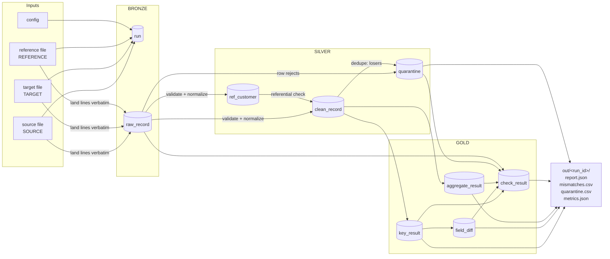
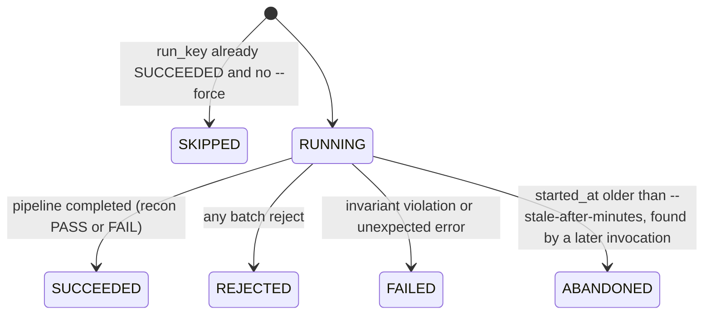

# recon — Design

Status: rev 3, all review questions resolved (2026-11-15). Every reason code, status and check name in
section 4 comes from the reviewed catalogue. Do not rename or add any of them without sign-off.

---

## 1. Problem and flow

1. Orders are exported from an OLTP system (SOURCE) and loaded into a warehouse (TARGET) under different column names.
2. We must prove that the warehouse holds the same orders as the source. We compare row counts, business keys, aggregates and individual field values.
3. Every difference and every rejected row must be explained, traceable to a file and line, and written to a machine-readable report.

Stage order inside one run: **batch checks** (a batch reject stops here) → **ingest** (bronze) →
**validate** → **dedupe** (silver) → **compare** → **aggregate** → **checks** (gold; an invariant
violation stops here) → **report**.

---

## 2. Logical schema and physical mapping

### 2.1 Logical schema (orders)

| logical field | type | required | normalization | rules | compared | tolerance |
|---|---|---|---|---|---|---|
| order_id | str | yes | trim, upper-case; leading zeros preserved | business key; non-empty | key | — |
| customer_id | str | yes | trim, upper-case | must exist in reference customers | yes | exact |
| order_ts | timestamp | yes | → UTC `YYYY-MM-DDTHH:MM:SSZ` (fractional seconds truncated) | valid timestamp | yes | exact (to the second) |
| status | enum | yes | trim, upper-case | one of PLACED, SHIPPED, DELIVERED, CANCELLED, RETURNED (case-insensitive) | yes | exact |
| amount | decimal(scale 2) | yes | Decimal → integer minor units | ≥ 0 | yes | 0.01 inclusive (≤ 1 minor unit) |
| currency | str(3) | yes | trim, upper-case | exactly 3 letters A–Z | yes | exact |
| discount | decimal(scale 2) | **no** (nullable) | Decimal → integer minor units; empty → NULL | ≥ 0 when present | yes | 0.01 inclusive |
| updated_at | timestamp | yes | → UTC `YYYY-MM-DDTHH:MM:SSZ` (fractional seconds truncated) | version field: latest wins | **no**, version metadata only | — |

Grain: one input row = one version of an order. SILVER keeps at most one row per `(run_id, side, order_id)`.

Aggregates: row count, SUM(amount), SUM(discount). Each is computed overall, grouped by status and grouped by currency.

### 2.2 Physical column mapping

| logical | SOURCE (OLTP export) | TARGET (warehouse load) |
|---|---|---|
| order_id | order_id | order_id |
| customer_id | customer_id | cust_id |
| order_ts | order_ts | order_timestamp |
| status | status | order_status |
| amount | amount | total_amount |
| currency | currency | currency_code |
| discount | discount | discount_amount |
| updated_at | updated_at | last_modified |

REFERENCE (customer list): `customer_id` (str, required, trim + upper-case, key) and `customer_name` (str, informational only).

The mapping is held in a single config file: the logical schema plus `columns.source` and `columns.target` maps. Header names are matched after trim + lower-case.

**File names.** Input file names are arbitrary: the SOURCE, TARGET and REFERENCE files are passed as CLI paths, and only their headers matter. The synthetic generator (`recon generate`) writes `source.csv`, `target.csv` and `customers.csv` into `data/generated/<name>/`; the committed sample uses the same names in `data/sample/`.

---

## 3. Tables (one SQLite DB)

Conventions:
- Every table carries `run_id`.
- `side` ∈ `SOURCE | TARGET | REFERENCE`.
- Timestamps are TEXT in the form `YYYY-MM-DDTHH:MM:SSZ`.
- Money is INTEGER minor units, with the `_minor` suffix.
- No floats anywhere. All SQL lives in `recon/repository`.

### BRONZE

**run** (written by `run_repo`, in its own transactions, separate from the data transaction)

| column | type | notes |
|---|---|---|
| run_id | TEXT | **PK**. `run_key[:16] + '-a' + attempt` |
| run_key | TEXT NOT NULL | sha256 hex (see section 5) |
| attempt | INTEGER NOT NULL | 1-based. UNIQUE(run_key, attempt) |
| status | TEXT NOT NULL | run status: RUNNING, SUCCEEDED, FAILED, REJECTED, SKIPPED, ABANDONED |
| recon_status | TEXT | PASS or FAIL. Set only when status = SUCCEEDED (for SKIPPED, copied from the reused run) |
| exit_code | INTEGER | 0, 1, 2 |
| forced | INTEGER NOT NULL | 0 or 1 (`--force`) |
| skipped_of_run_id | TEXT | for SKIPPED: the SUCCEEDED run_id that was reused |
| source_file / target_file / reference_file | TEXT NOT NULL | paths as given |
| source_sha256 / target_sha256 / reference_sha256 | TEXT | raw-bytes hash. NULL if the file is missing |
| config_sha256 | TEXT NOT NULL | canonical config hash |
| started_at / finished_at | TEXT | the only non-deterministic columns |
| failure_reason | TEXT | REJECTED: the batch-reject code. FAILED: `INVARIANT_VIOLATION:<check>` or `UNEXPECTED_ERROR`. ABANDONED: `STALE_RUNNING` |
| failure_detail | TEXT | REJECTED: every batch reject as JSON `[{side, file, code, detail}]`. FAILED: invariant counts as JSON, or the exception type and message |

**raw_record** (written by `bronze_repo`)

| column | type | notes |
|---|---|---|
| run_id | TEXT | PK part |
| side | TEXT | PK part |
| line_no | INTEGER | PK part. 1-based physical line where the record **starts**; header = 1 |
| source_file | TEXT NOT NULL | |
| record_type | TEXT NOT NULL | HEADER or DATA |
| raw_text | TEXT NOT NULL | exact record text, without the trailing newline |

PK `(run_id, side, line_no)`. Records are landed verbatim and nothing is parsed at this stage. The only lines not landed are blank lines (section 7.1, assumption 15).

### SILVER

**clean_record** (written by `silver_repo`). Holds the surviving order version per key.

| column | type | notes |
|---|---|---|
| run_id, side | TEXT | PK part. side ∈ SOURCE or TARGET |
| order_id | TEXT | PK part |
| customer_id | TEXT NOT NULL | |
| order_ts | TEXT NOT NULL | UTC ISO |
| status | TEXT NOT NULL | |
| amount_minor | INTEGER NOT NULL | |
| currency | TEXT NOT NULL | |
| discount_minor | INTEGER NULL | |
| updated_at | TEXT NOT NULL | |
| payload_sha256 | TEXT NOT NULL | sha256 of the canonical normalized logical fields (all 8, fixed order, NULL rendered as `\N`) |
| source_file | TEXT NOT NULL | |
| line_no | INTEGER NOT NULL | line of the kept version |

PK `(run_id, side, order_id)`.

**ref_customer** (written by `silver_repo`). Holds the validated reference customers.

| column | type | notes |
|---|---|---|
| run_id | TEXT | PK part |
| customer_id | TEXT | PK part. trim + upper-case |
| customer_name | TEXT | informational |

PK `(run_id, customer_id)`.

**quarantine** (written by `silver_repo`). Holds every excluded **data record**: row rejects and duplicate losers. Batch rejects are not stored here; they go on the `run` row.

| column | type | notes |
|---|---|---|
| run_id, side | TEXT | PK part |
| line_no | INTEGER | PK part. ≥ 2 (data records only) |
| source_file | TEXT NOT NULL | |
| raw_text | TEXT NOT NULL | |
| category | TEXT NOT NULL | ROW_REJECT or DUPLICATE |
| reason_code | TEXT NOT NULL | from the catalogue (section 4) |
| field_name | TEXT NULL | logical field of the first failure, if any |
| order_id | TEXT NULL | normalized key if one could be extracted (used for *_REJECTED and CONFLICT) |
| updated_at | TEXT NULL | canonical updated_at if it parsed, even on a rejected row (used for version ordering, section 4.4) |
| detail | TEXT NOT NULL | human-readable. For row rejects: every failure, `;`-separated, in field order |

PK `(run_id, side, line_no)`. Each data record is either clean or quarantined exactly once.

### GOLD (all written by `gold_repo`)

**key_result**: one row per business key in the union of both sides (clean, or quarantined with a key).

| column | type | notes |
|---|---|---|
| run_id | TEXT | PK part |
| order_id | TEXT | PK part |
| key_status | TEXT NOT NULL | catalogue (section 4) |
| source_line_no / target_line_no | INTEGER NULL | kept version, or the deciding quarantined line |
| source_updated_at / target_updated_at | TEXT NULL | |
| diff_count | INTEGER NOT NULL | number of field_diff rows |
| note | TEXT NULL | `rejected on both sides` when both sides rejected the key; otherwise NULL |

**field_diff**: one row per differing compared field of a key that has clean rows on both sides.

| column | type | notes |
|---|---|---|
| run_id, order_id, field_name | TEXT | **PK** |
| source_value / target_value | TEXT NULL | normalized text. Money rendered as `123.45` |
| delta_minor | INTEGER NULL | source − target, for money fields only |
| diff_type | TEXT NOT NULL | NULL_MISMATCH, TARGET_STALE, TARGET_AHEAD or VALUE_MISMATCH |

**aggregate_result**

| column | type | notes |
|---|---|---|
| run_id | TEXT | PK part |
| metric | TEXT | PK part: ROW_COUNT, SUM_AMOUNT or SUM_DISCOUNT |
| group_by | TEXT | PK part: ALL, STATUS or CURRENCY |
| group_value | TEXT | PK part. `*` for ALL |
| source_value / target_value | INTEGER NOT NULL | count or minor units. NULL discounts ignored; an empty group = 0 |
| delta | INTEGER NOT NULL | source − target |
| explained_delta | INTEGER NOT NULL | delta rebuilt bottom-up from key_result (section 4.6) |
| unexplained_delta | INTEGER NOT NULL | delta − explained_delta |

**check_result**

| column | type | notes |
|---|---|---|
| run_id, check_name | TEXT | **PK** |
| severity | TEXT NOT NULL | INVARIANT or WARN |
| status | TEXT NOT NULL | PASS or WARN. An invariant FAIL is never persisted, because the run rolls back (section 4.7) |
| expected / actual | TEXT | |
| detail | TEXT NOT NULL | canonical JSON (sorted keys). Warning checks: `[{"side": ..., "columns": [...]}]` sorted by side |

---

## 4. Catalogues

### 4.1 Batch rejects (the run becomes REJECTED, exit 2)

| code | when |
|---|---|
| FILE_NOT_FOUND | path does not exist or is not a file |
| EMPTY_FILE | zero bytes, or no non-blank header line |
| ENCODING_ERROR | bytes are not valid UTF-8 (a leading UTF-8 BOM is stripped first) |
| DUPLICATE_HEADER | two header names are equal after trim + lower-case |
| SCHEMA_MISSING_COLUMN | the physical column of a **required** logical field is absent |

Applies to SOURCE, TARGET and REFERENCE. All three files are checked so that every batch reject is reported.

Batch rejects are **not** stored in quarantine. The data transaction rolls back. The separately committed `run` row then gets:
- `status = REJECTED`;
- `failure_reason` = the first code in SOURCE → TARGET → REFERENCE order;
- `failure_detail` = all of them as JSON.

### 4.2 Batch warnings (the run continues)

| code | when | effect |
|---|---|---|
| SCHEMA_EXTRA_COLUMN | header has a column that is not in the mapping | column ignored |
| MISSING_OPTIONAL_COLUMN | the physical column for `discount` is absent | discount = NULL for every row on that side |
| EMPTY_BATCH | valid header, zero data records | side contributes no keys |

No extra table is used. Each warning is reported in two places:
- one `check_result` row per warning check (section 4.7: SCHEMA_DRIFT, MISSING_OPTIONAL_COLUMN, EMPTY_BATCH), whose JSON detail lists side and columns;
- a top-level `"warnings"` array in `report.json`: `[{"code", "side", "columns"}]`, sorted by code then side.

### 4.3 Row rejects (written to quarantine, category ROW_REJECT)

| code | when |
|---|---|
| MALFORMED_ROW | field count ≠ header count, or a CSV quoting error |
| MISSING_REQUIRED | a required field is empty after trim |
| BAD_TYPE | value is not interpretable as the type at all (e.g. `abc` as amount, `yesterday` as timestamp) |
| BAD_FORMAT | value is recognizably the type but in a disallowed form: comma decimal / thousands separators (`1.234,56`, `1,234.56`), scale > 2, exponent, leading `+` or `.`, currency symbol, non-ISO date (`15/11/2026`), date-only timestamp, currency not `[A-Z]{3}` |
| BAD_ENUM | status not in the enum after upper-casing |
| OUT_OF_RANGE | amount < 0 or discount < 0 |
| INVALID_REFERENCE | customer_id not in ref_customer |

Validation order is fixed: MALFORMED_ROW first, then field by field in logical-schema order. Within a field, checks run MISSING_REQUIRED → BAD_TYPE/BAD_FORMAT → BAD_ENUM → OUT_OF_RANGE. INVALID_REFERENCE is checked last, only on rows that passed everything else.
- `reason_code` is the first failure; `detail` lists all of them.
- Every field is still parsed after the first failure, so a rejected row keeps its `order_id` and `updated_at` whenever those two parsed.
- A MALFORMED_ROW has no trusted fields, so its `order_id` and `updated_at` are NULL.

### 4.4 Duplicate dispositions and version ordering (written to quarantine, category DUPLICATE)

Version ordering is per `(side, order_id)` and covers **every** row of the key whose `updated_at` parsed, **including rejected rows**. Rows whose `updated_at` did not parse cannot win; they stay ROW_REJECT and are ignored for ordering. Let `max_u` be the maximum `updated_at` over the participating rows.

1. **If any rejected row is at `max_u`**, the newest version is rejected. This includes a tie with valid rows at the same `max_u`, which is treated as rejected (conservative):
   - the key has no clean row (it gets SOURCE_REJECTED / TARGET_REJECTED, section 4.5);
   - **every** valid row of the key becomes SUPERSEDED, with detail `shadowed by rejected line N`, which explains the label even when the valid row is not strictly older;
   - there is no fallback to an older valid version.
2. **Otherwise**, only valid rows are at `max_u`:

| code | rule |
|---|---|
| SUPERSEDED | valid row with `updated_at < max_u`. The newest version wins regardless of file order |
| DUPLICATE_EXACT | among valid rows at `max_u`, every `payload_sha256` is identical. The lowest line_no is kept; the others get this code |
| CONFLICTING_DUPLICATE | among valid rows at `max_u`, payloads differ. **All** rows at `max_u` are quarantined, no row is kept, and the key gets status CONFLICT |

Rejected rows keep their ROW_REJECT code in every case; they are never re-labelled.

### 4.5 Key statuses (evaluated in this order; the first match wins)

| status | condition |
|---|---|
| CONFLICT | key has a CONFLICTING_DUPLICATE on either side |
| MATCHED | clean on both sides, zero field diffs |
| MISMATCHED | clean on both sides, ≥ 1 field diff |
| SOURCE_REJECTED | no clean source row, and the source has a ROW_REJECT for this key |
| TARGET_REJECTED | clean source row, no clean target row, and the target has a ROW_REJECT for this key |
| MISSING_IN_TARGET | clean source row, nothing for the key on the target side |
| EXTRA_IN_TARGET | clean target row, nothing for the key on the source side |

If both sides rejected the key, the status is SOURCE_REJECTED and `key_result.note = 'rejected on both sides'`.

### 4.6 Diff types (per compared field; precedence in this order)

1. **NULL_MISMATCH**: exactly one side is NULL. Only `discount` can be NULL, and NULL ≠ 0.
2. Otherwise, if the values differ beyond tolerance:
   - **TARGET_STALE**: `target.updated_at < source.updated_at`
   - **TARGET_AHEAD**: `target.updated_at > source.updated_at`
   - **VALUE_MISMATCH**: `updated_at` is equal on both sides

Money fields are equal when `|src_minor − tgt_minor| ≤ 1`. All other fields use exact equality after normalization.

**Explained delta** for each aggregate row is computed by walking key_result:
- a key with only a source row adds its source value to the source group;
- a key with only a target row subtracts its target value from the target group;
- a key with rows on both sides adds `src` to the group of its source status/currency and `−tgt` to the group of its target status/currency (in-tolerance differences included).

This is computed independently of the SQL `SUM` that produces `source_value` and `target_value`.

### 4.7 Checks

Two kinds of check:
- **INVARIANT** checks test the engine, not the data. Conflicts and bad references are already quarantined before gold is built, so on correct code these always pass.
  - If one fails, it is a bug. The data transaction rolls back and the run becomes FAILED (exit 2).
  - `failure_reason = INVARIANT_VIOLATION:<check>` and `failure_detail` = the counts as JSON.
- **WARN** checks report batch warnings. They never change run status or recon status.

| check | severity | PASS when |
|---|---|---|
| SRC_ROW_ACCOUNTING | INVARIANT | landed SOURCE DATA records in raw_record = clean SOURCE rows + SOURCE quarantine rows. Blank lines are not landed, so they are not counted |
| TGT_ROW_ACCOUNTING | INVARIANT | same, for TARGET |
| KEY_UNIQUENESS | INVARIANT | clean_record has ≤ 1 row per (side, order_id), and key_result has ≤ 1 row per order_id |
| REFERENTIAL_INTEGRITY | INVARIANT | every clean_record.customer_id exists in ref_customer for the run |
| KEY_COVERAGE | INVARIANT | key_result has exactly the set of order_ids in clean_record ∪ keyed quarantine rows (SOURCE/TARGET): none missing, none extra |
| AGGREGATE_EXPLAINED | INVARIANT | `unexplained_delta = 0` on every aggregate_result row |
| SCHEMA_DRIFT | WARN | no SCHEMA_EXTRA_COLUMN on any side; otherwise WARN, detail = `[{side, columns}]` |
| MISSING_OPTIONAL_COLUMN | WARN | no side is missing an optional column; otherwise WARN, detail = `[{side, columns}]` |
| EMPTY_BATCH | WARN | no side has zero data records; otherwise WARN, detail = `[{side, columns: []}]` |

All nine rows are written on every SUCCEEDED run, with PASS or WARN, so the report shape is stable.

### 4.8 Recon status (data verdict; only for SUCCEEDED runs)

Data problems (rejects, conflicts, mismatches) only ever affect `recon_status`. They never affect run status.

`recon_status = PASS` iff both of these hold; otherwise FAIL:
- every key_result row is MATCHED;
- there are no SOURCE or TARGET ROW_REJECT rows without an `order_id`.

The second condition exists because unattributable records, such as a MALFORMED_ROW, cannot be shown to match. SUPERSEDED and DUPLICATE_EXACT rows, and rejects of older versions that did not win, do not fail recon on their own. Reference-side rejects do not fail recon directly; their effect shows up as INVALID_REFERENCE on orders.

---

## 5. Run lifecycle

- `run_key = sha256( source_sha256 + "\n" + target_sha256 + "\n" + reference_sha256 + "\n" + config_sha256 )`.
  - File hashes are taken over raw bytes. A missing file hashes as the literal `MISSING`.
  - `config_sha256` = sha256 of `json.dumps(config, sort_keys=True, separators=(",", ":"), ensure_ascii=False)`, taken after defaults are applied.
- `run_id = run_key[:16] + "-a" + attempt`, where `attempt = (number of existing run rows for run_key) + 1`.
- Run status (engine health) and recon status (data verdict) are separate. See section 4.8.
- Exit codes:

| exit | meaning |
|---|---|
| 0 | SUCCEEDED with recon PASS (or SKIPPED reusing a PASS run) |
| 1 | SUCCEEDED with recon FAIL (or SKIPPED reusing a FAIL run) |
| 2 | FAILED or REJECTED; also "run in progress" (section 6) |

---

## 6. Idempotency, retry, restart, backfill

1. **One transaction per run.**
   - The `run` row is inserted as RUNNING and committed on its own, so crashes are detectable.
   - All bronze, silver and gold writes happen in **one** data transaction, which commits together with the final `run` update to SUCCEEDED.
   - On REJECTED or FAILED (including an invariant violation), the data transaction is rolled back. A separate short transaction then sets the run status, `failure_reason` and `failure_detail`.
   - A run never leaves partial bronze, silver or gold data, and REJECTED and FAILED runs leave none at all.
2. **Idempotency / SKIPPED.** If any attempt for the run_key is SUCCEEDED and `--force` is not given:
   - a SKIPPED run row is recorded with `skipped_of_run_id`, and no stages run;
   - report files are **not** rewritten; the existing report path is printed;
   - the process returns that run's exit code;
   - no new rows are written to raw_record, clean_record, ref_customer, quarantine or any gold table (the SKIPPED `run` row is the only write).
3. **`--force`** starts a new attempt (`forced = 1`) even when a SUCCEEDED attempt exists. Earlier attempts stay untouched, because every row is scoped by run_id.
4. **Retry.** After FAILED, REJECTED or ABANDONED, re-running the same inputs simply creates the next attempt. No flag is needed.
5. **Restart / stale RUNNING.** Before starting, look for a RUNNING attempt with the same run_key:
   - If its `started_at` is older than `--stale-after-minutes` (CLI flag, default 60, not part of the config hash), it becomes ABANDONED (`failure_reason = STALE_RUNNING`) and a new attempt starts.
   - Otherwise, print `run in progress`, exit 2 and create no row.
   - There are no PID checks. Restart never resumes mid-run; it always reprocesses from the input files.
6. **Backfill.** `recon backfill --manifest PATH`.
   - The manifest is a CSV with columns `batch_id, source_path, target_path, reference_path`.
   - It produces one independent run per manifest line, in file order, using all of the rules above.
   - A failing line does not stop the others.
   - At the end it prints a summary table (`batch_id, run_id, status, recon_status, exit_code`) sorted by batch_id.
   - The process exit code is the maximum over all lines.
   - Re-running the same manifest skips pairs that already SUCCEEDED, so backfill is idempotent.

---

## 7. Assumptions and known limitations

### 7.1 Assumptions

1. **Encoding.** Files are UTF-8; a BOM is tolerated and stripped. Delimiter `,`, quote `"`, standard CSV escaping. Records may span lines inside quotes; `line_no` is the start line.
2. **Headers.** Header names are trimmed and lower-cased before mapping. Column order is irrelevant.
3. **Empty values.** Every value is trimmed. Empty after trim = NULL. Literal strings such as `NULL`, `null` or `None` are *values*, not NULL, so they fail type checks.
4. **Timestamps.**
   - Accepted forms: `YYYY-MM-DD[T| ]HH:MM:SS[.fraction]` with optional `Z` or `±HH:MM` offset.
   - Naive timestamps are UTC. Offsets are converted to UTC.
   - Fractional seconds are accepted and **truncated** to whole seconds in the canonical form. Warehouses commonly truncate milliseconds, and comparing at second precision avoids false mismatches.
5. **Money.** Accepted form: `^-?\d+(\.\d{1,2})?$`. EU number format and thousands separators are rejected, not guessed. Values are parsed with `Decimal` and stored as integer minor units.
6. **Order ID.** `order_id` is never numerically coerced: `0012` ≠ `12`. Keys sort by SQLite BINARY collation (byte order) everywhere.
7. **Discounts.** A NULL discount is not 0. `SUM_DISCOUNT` ignores NULLs.
8. **Cross-currency sums.** Overall (`ALL`) money sums add minor units across currencies. They are reported for completeness, but only the CURRENCY grouping is financially meaningful.
9. **Rejected newest version.** A rejected newest version shadows older valid versions (section 4.4). The key is reported as rejected; it never falls back to stale data.
10. **Reference file.**
    - Reference rows with an empty customer_id are row-rejected (MISSING_REQUIRED, side REFERENCE).
    - Duplicate customer_ids keep the first occurrence and are not quarantined, since only existence matters.
11. **Exact duplicates.** "Identical payload" means identical *normalized* logical fields, so whitespace or case differences that normalize away count as identical.
12. **Determinism scope.**
    - Same inputs + same config + a fresh DB give byte-identical outputs except `started_at`, `finished_at` and `metrics.json`.
    - A `--force` attempt changes only the `-aN` suffix of run_id.
    - JSON is written with sorted keys, `ensure_ascii=False` and a final `\n`.
    - CSV is written with `newline=""` and `lineterminator="\n"`.
13. **Metrics.** Timings and peak memory go to `metrics.json` only, never into `report.json`, so the report stays byte-comparable.
14. **Unexpected columns.** Extra columns are ignored, never compared.
15. **Blank lines.** Blank lines (empty or whitespace-only, outside any quoted field) between or after data records are **not** landed in raw_record and **not** quarantined.
    - They are counted per side in `metrics.json` as `blank_lines`.
    - `line_no` stays the physical line number, so it skips over blank lines.
    - Row accounting covers landed DATA records only.

### 7.2 Known limitations

1. All currencies are treated as 2 decimal places. Zero-decimal currencies (JPY) and 3-decimal currencies (KWD) are not supported.
2. Currency codes are only checked for shape (`[A-Z]{3}`), not against ISO 4217.
3. Timestamp comparison is at whole-second precision. Sub-second differences are invisible.
4. There is no concurrency control beyond the RUNNING/stale rule; two processes started within the same instant on the same inputs are not guarded against (no PID or lock checks).
